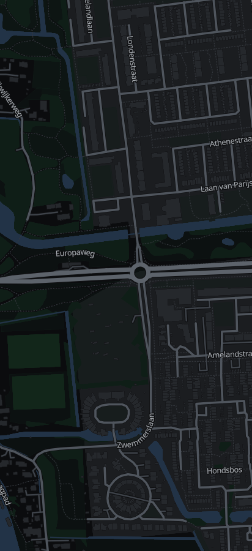

# Woozy

Native Android driving app: live GPS, speed, speed-limit sign, crowd reports and (from Phase 4) turn-by-turn navigation. Kotlin + Jetpack Compose, MapLibre, OpenStreetMap data. Original branding; the main screen layout follows a dark "speed camera app" style reference.



*Map style rendered from `app/src/main/assets/map/woozy_dark.json` with live OpenFreeMap tiles (headless MapLibre GL JS, same style spec as MapLibre Native).*

## Status

| Phase | Scope | State |
|---|---|---|
| 1 Foundation | Gradle, Hilt, theme, app shell, bottom navigation | ✅ Done |
| 2 Map | MapLibre, dark style, GPS, puck, heading-up/north-up, follow + recenter, 3D tilt | ✅ Done |
| 3 Driving UI | Speed, real speed limits (OSM via Valhalla), configurable speeding warning, Report button, voice control, Home/Work | ✅ Done |
| 4 Navigation | Search (Photon), route preview with alternatives + options, turn-by-turn with voice, rerouting, ETA, arrival | ✅ Done (foreground only — see Phase 6) |
| 5 Traffic | Local crowd reports + map markers ✅, provider-based cameras/traffic ❌ | Partial |
| 6 Background | Foreground service, notification, background GPS | ❌ |
| 7 Settings/persistence | DataStore settings ✅, Room reports + recents + Home/Work ✅ | Mostly done |
| 8 Testing | 36 offline JVM unit tests + 3 opt-in live routing tests, lint clean (0 errors) | Ongoing |

### What works now (no API keys needed)

- **Map**: full-screen MapLibre map, custom dark style (OpenMapTiles schema) on free OpenFreeMap vector tiles. Road names, ref shields, water, parks.
- **GPS**: fused provider (Play services) with automatic fallback to platform GPS/network on de-Googled phones. GPS runs only while the map is visible (stops ~5 s after backgrounding).
- **Camera**: follows the user, direction-up (rotates with GPS course) or north-up, optional 3D tilt, puck placed in the lower third when direction-up. Panning stops following → recenter button.
- **Puck**: blue dot when stationary, navigation arrow while moving; bearing is frozen below ~5 km/h so the map doesn't spin at traffic lights.
- **Speed**: Doppler GPS speed when its accuracy is good, position-derived fallback, spike rejection, EMA smoothing, 0 below ~3 km/h, `--` when GPS is lost. km/h or mph.
- **Speed limit sign**: red ring / white centre, posted limit from OpenStreetMap `maxspeed` via Valhalla. While navigating, limits for the whole route are fetched once (`trace_attributes`, edge walk) and looked up by position — no per-second requests. While free-driving, the last few GPS points are map-matched at most every 8 s while moving. No data → `--`; it never guesses from road type. mph users see the nearest 5 mph.
- **Speeding warning**: speed turns red and the sign pulses at limit + threshold (Over / +5 / +10 / +15, in your unit). Optional spoken warning after 3 s of speeding, then at most once a minute unless the limit changes.
- **Current road name**: read from the vector tiles under the GPS position (invisible query layer). No network call.
- **Status**: GPS searching / weak / lost chips, offline chip, permission and "location off" cards (one-tap enable via Play services).
- **Report button**: 10 report types, attached to the current fresh GPS fix + heading + road name, stored in Room, shown on the map and in the List tab, auto-expire per type. Duplicate guard: same type within 200 m / 10 min, plus a 4 s double-tap guard. Spoken + on-screen confirmation.
- **Voice**: speaker button mutes/unmutes everything spoken (TTS on the navigation audio stream, ducks music). Mic opens speech recognition; commands: "report accident / traffic jam / police / …", "navigate to X" (opens search with X), "navigate home/work" (routes and starts immediately if saved), "cancel", "repeat". English + Dutch keywords. Falls back to typing if no recogniser exists.
- **Search**: Photon geocoder, 350 ms debounce, results ranked near you with distances, Home/Work shortcuts, recent destinations (Room). Selecting a result drops a pin; the card offers **Route**, **Home**, **Work**.
- **Route preview**: up to 3 alternatives with duration, distance, arrival time, toll/ferry badges; Fastest/Shortest and avoid tolls/highways/ferries (saved as defaults); camera fits all routes.
- **Turn-by-turn**: blue maneuver banner (arrow, distance, instruction, "then" hint), route ahead drawn in blue and trimmed as you drive, arrival time / remaining time / distance, End button. Speed-based zoom (17 / 16 / 15) in direction-up.
- **Voice guidance**: Valhalla's English instructions — an early "In 400 metres, …" (≈30 s ahead, scaled with speed), a call at the maneuver (≈7 s), and "Continue for 12 kilometres" before long stretches. Roundabout exits aren't announced separately; when an instruction already says "Then …", the follow-up isn't announced twice.
- **Rerouting**: 3 consecutive accurate fixes > 30 m + accuracy off the route → new route from your position using your heading (no U-turn starts), at most every 8 s. Arrival within 25 m of the end.
- **Settings** (DataStore): auto-follow, direction-up/north-up, 3D, keep screen on, units, voice on/off, volume, speech rate, test voice.

### Deliberately not done yet (and not faked)

- **Background navigation (Phase 6, next)**: GPS and guidance run only while the app is on screen. With the screen off or another app in front, guidance pauses until you return. "Keep screen on" (default on) avoids this in the car for now.
- **Live traffic in ETAs**: Valhalla's public instance has no live traffic; ETAs are free-flow estimates.
- **Speed cameras, traffic, incidents from others**: need a data provider/backend. The List tab says so explicitly. No mock data is shown.
- **Report sharing / confirm / dismiss of others' reports**: `ReportRemoteDataSource` is bound to `NoBackendReportDataSource`; reports are labelled "This device".
- **Foreground service / background navigation**: Phase 6, together with the background-location and notification permissions (not requested before they're needed).

## Architecture

MVVM, single activity, Hilt. Interfaces only where providers must be swappable.

```
UI (Compose)  ── MapScreen / ReportsList / Search / Settings / Menu
   │              MapController (imperative MapLibre wrapper: camera, puck, markers)
ViewModels    ── MapViewModel, ReportsViewModel, SearchViewModel, SettingsViewModel
   │
Repositories  ── LocationRepository   (single GPS consumer, WhileSubscribed)
               ── SettingsRepository  (DataStore)
               ── ReportRepository    (Room + ReportPolicy + ReportRemoteDataSource)
               ── DestinationRepository (GeocodingProvider + Room recents)
   │
Navigation    ── NavigationManager (preview → guidance → reroute → arrival), RouteTracker, VoiceGuidance
   │
Providers     ── GeocodingProvider      → PhotonGeocodingProvider
 (interfaces)  ── RoutingProvider        → ValhallaRoutingProvider
               ── SpeedLimitProvider     → ValhallaSpeedLimitProvider (route spans / map matching)
               ── ReportRemoteDataSource → NoBackendReportDataSource
Services      ── VoiceAlertManager (TTS, audio focus, de-duplication)
```

Why no navigation-compose: the GL `MapView` must stay alive across tabs and pages; re-creating it costs a style reload and a visible flash. The map is always composed and other pages are drawn on top (`ui/WoozyAppRoot.kt`).

GPS fixes go straight from `LocationRepository` into `MapController` outside composition, so the map doesn't recompose per fix.

### Project structure

```
app/src/main/kotlin/app/woozy/
├── WoozyApp.kt, MainActivity.kt
├── di/            AppModule (Room, DataStore, OkHttp, Retrofit), provider bindings
├── domain/model/  LocationFix, Settings, SpeedLimit, TrafficReport/ReportType, Place
├── data/
│   ├── api/        PhotonApi, ValhallaApi + DTOs
│   ├── database/   Room entities, DAOs, WoozyDatabase
│   ├── providers/  GeocodingProvider, RoutingProvider, SpeedLimitProvider, ReportRemoteDataSource
│   └── repository/ Settings, Report, Destination repositories
├── location/      LocationRepository, SpeedCalculator, LocationStatusMonitor, ConnectivityMonitor
├── navigation/    NavigationManager, RouteTracker, RouteGeometry, VoiceGuidance, PolylineCodec
├── traffic/       ReportPolicy, SpeedingAlerter
├── services/      VoiceAlertManager
├── voice/         VoiceCommandParser
├── util/          Geo (haversine, bearing, bbox), distance formatting
└── ui/            theme, components, map, reports, search, settings, menu, permissions
app/src/main/assets/map/woozy_dark.json   generated by tools/generate_map_style.py
```

## Provider choices

| Need | Choice | Why | Cost |
|---|---|---|---|
| Map SDK | **MapLibre Native Android 13.7** | Open-source, vector tiles, built-in location component with GPS tracking modes, no vendor lock-in or key | Free |
| Tiles | **OpenFreeMap** (OpenMapTiles schema) | No key, no request limits, OSM-based | Free (donation-funded; self-host or MapTiler for production SLAs) |
| Geocoding | **Photon** (komoot) | Built for search-as-you-type. Nominatim's policy forbids autocomplete, so it's only suitable for one-shot lookups | Free fair-use; self-host for production |
| Routing + speed limits | **Valhalla** | Fastest *and* shortest, avoid tolls/highways/ferries, turn-by-turn instructions incl. Dutch, and OSM `maxspeed` per edge (solves speed limits too). OSRM's demo server can't do shortest route or per-request avoid options; GraphHopper's hosted API needs a key | Public FOSSGIS instance for dev only; self-host (free) or Stadia Maps (paid) |
| Live traffic / cameras | None configured | No free, legal real-time source covers this. Options: NDW open data (NL traffic + roadworks, free), TomTom/HERE traffic (paid), own backend for crowd reports | — |

All endpoints are configurable without code changes via `secrets.properties` (git-ignored) or Gradle properties: `MAP_TILES_URL`, `MAP_GLYPHS_URL`, `GEOCODER_BASE_URL`, `ROUTING_BASE_URL`.

**Production caveat:** the default routing server is the FOSSGIS public Valhalla instance (`valhalla1.openstreetmap.de`) — free, but meant for light/test use with no SLA. Before real users: self-host Valhalla (Docker image + OSM extract for NL/Benelux; a small VPS is enough) or use a paid host such as Stadia Maps. The app needs no code change.

**Speed-limit data caveat:** on the Haarlem→Amsterdam test route every edge returned a limit (50/80/90/100), which is plausible given high OSM `maxspeed` coverage in NL. I have not verified whether this server fills untagged roads with country defaults; spot-check on a drive. Valhalla's `255` ("no limit") and `0` are shown as `--`.

## Backend contract (prepared, not implemented)

```
GET  /api/reports/nearby?lat=&lon=&radius=
POST /api/reports
POST /api/reports/{id}/confirm
POST /api/reports/{id}/dismiss
GET  /api/cameras/nearby   GET /api/traffic/nearby   GET /api/roadworks/nearby
GET  /api/speedlimits      GET /api/routes
GET/POST /api/user/settings
```

Implement `ReportRemoteDataSource` (and later traffic/camera providers) and swap the binding in `di/AppModule.kt`. `ReportPolicy.applyRemoteTtls()` takes server-side expiry overrides. Confidence thresholds (1 / 3 / 5 confirmations) and abuse prevention (per-device rate limits, reputation) belong on the server; the client already blocks duplicates and double taps.

## Build & run

Requirements: Android Studio with **AGP 9.5**, JDK 21, Android SDK **platform 37.1** (Compose 1.13 requires compileSdk 37.1), a phone with Android 8.0+ (API 26).

```bash
./gradlew :app:assembleDebug          # app/build/outputs/apk/debug/app-debug.apk
./gradlew :app:testDebugUnitTest      # JVM unit tests (offline)
WOOZY_LIVE_TESTS=1 ./gradlew :app:testDebugUnitTest --tests '*LiveValhallaTest*'  # hits the routing server, simulates a drive
./gradlew :app:lintDebug
```

The release build is R8-minified and, for convenience, signed with the debug key; replace `signingConfig` before publishing.

Test on a real device outdoors or in a car: emulators don't produce meaningful GPS speed/bearing. To simulate a drive, use Android Studio's *Extended controls → Location → Routes*.

## Privacy

Location is read only while the app is on screen; no location history is stored. Reports and recent destinations stay on the device and are excluded from cloud backup. Search sends the query plus approximate position to the geocoder. HTTP requests carry a generic User-Agent without user data.

## Regenerating the map style

```bash
python3 tools/generate_map_style.py app/src/main/assets/map/woozy_dark.json
```

Colours, widths and layers live in the script; the JSON is generated output.

## Attribution

Map data © OpenStreetMap contributors (ODbL). Tiles: OpenFreeMap, schema © OpenMapTiles. Search: Photon by komoot. Attribution is always visible on the map.
